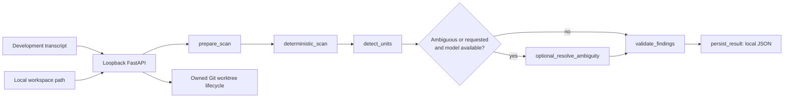

# Stage 1 architecture

VoxOps is a trusted **local executor**. It reads filesystem evidence and manages isolated Git
worktrees. Its loopback API is a development boundary for the future VS Code extension. A hosted
control plane cannot read a user's filesystem without a local executor. Do not publish this API or
place it behind a proxy that makes remote requests appear to originate on loopback.

The graph has fixed enum destinations and structured error stops. The PydanticAI specialist is a
single bounded agent with typed output, no shell tools and no file mutations. Its evidence is capped
JSON containing relative paths, framework flags and specific questions. Transcript text never goes
to this specialist. Explicit configuration and filesystem classifications override AI suggestions;
only unknown roles may be conservatively refined. Model failure returns deterministic findings.

`domain/models.py` defines version-1 aggregate contracts and rejects unknown fields. Stable unit IDs
hash normalized relative root and deterministic role. Scanner fingerprints identify canonical roots
without returning absolute paths; input fingerprints hash targeted inputs and HEAD. Fingerprints
are evidence identifiers, not a full-tree integrity guarantee. Source files are never imported.

The scanner spends a global entry budget (including directories), bounds depth and bytes per file,
skips symbolic links, generated/cache/sensitive directories, and retains only targeted facts. All
environment configuration has **names and presence metadata only**. Raw `.env` values never enter
results, model context, logs or persisted scans. Manifest commands outside a narrow safe grammar
are redacted. No project install/build scripts run. Syntax matching is conservative rather than a
JavaScript interpreter: dynamic configuration and SSR requirements remain review questions.

Framework adapters are a fixed registry: Next.js, React/Vite, FastAPI. Package ownership uses the
nearest manifest. Node lockfiles are inherited from workspace ancestors. Python requirements and
pyproject dependencies at the same root merge. Shared library builds do not become deployments;
local package links are recorded separately from deployment dependencies. URL-like configuration
names alone cannot establish producer/consumer links, so Stage 1 does not invent them.

`ScanStore` stores one private, atomically replaced JSON file per result. Worktree ownership metadata
uses the same private local directory. This is **not MongoDB persistence or durable LangGraph
checkpointing**. Interrupted scans must be rerun; hosted crash-resume is deferred. Worktree records
survive restarts, and `GET /api/v1/worktrees` inspects their live Git status. Git worktrees isolate
changes; they are **not a security sandbox**. Operate only on trusted local repositories, and do not
mutate source paths concurrently with scans or cleanup.

Voice uses the `SpeechToTextProvider` interface. `TranscriptStub` is an explicit text passthrough.
`GnaniSpeechToText` always reports `gnani_not_configured` pending a verified account contract and
live credentials. No audio is accepted over the Stage 1 JSON API or stored. The transcript path is
for deployment intent, never spoken credentials; obvious key/password patterns are rejected.

Future stages add cloud compatibility/ranking, artifact workers and per-artifact retry budgets,
provider authentication, branch approval/deployment, URL propagation, Clerk and server-side quotas,
and the voice-first VS Code UI. None is implemented here.
