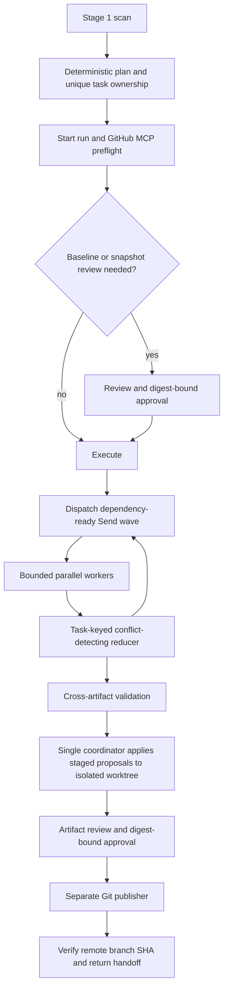

# Stage 2 architecture

Stage 2 plans artifacts from a fresh Stage 1 scan, generates or validates them in isolation, and publishes an approved Git revision. It does not deploy an application. The supplied Stage 2 goal defines the intended scope and is kept locally rather than published.

Workers own unique planned paths and stage proposals in private storage. The reducer rejects conflicting results for one task. A barrier dispatches a later wave only when its dependencies pass, validate as existing, or are skipped. A failed dependency blocks its descendants, while successful siblings remain recorded. A project lock and one coordinator protect writes to the worktree. Source bytes, file hashes, and the plan bind the review to the actual change.

GitHub MCP supplies repository identity, visibility, permissions, and creation. Git performs the branch and commit operations over HTTPS. The publisher checks the remote SHA before returning `ready_for_deployment`. The result always reports `deployment_executed: false`.

The design uses [LangGraph Send](https://reference.langchain.com/python/langgraph/types/Send) for dynamic fan-out, [PydanticAI typed output](https://pydantic.dev/docs/ai/core-concepts/output/) for bounded model responses, and [Git worktrees](https://git-scm.com/docs/git-worktree) for isolation. See [decisions](stage2-decisions.md), [usage](stage2-usage.md), and [security](stage2-security.md).

The API service owns the project lock, durable run and source binding. WorktreeManager retains ownership and cleanup rules. GitPublisher creates worktrees with raw committed blobs to preserve EOL bytes and executable modes without invoking checkout filters. Initial Git setup and baseline publication are a distinct approved operation. Dirty snapshots have their own exact selection review. Generated changes need another approval before commit/push.

Review identity includes the full plan digest, policy-code/configuration digest, source branch and HEAD, file hashes/modes, repository identity, expiration and displayed diff. Publication rechecks actual files, the exact candidate index and remote SHA. Completed task ledgers and deterministic commits permit operation-level reconciliation. Full LangGraph node checkpointing remains Stage 4 work.

The handoff is a Git branch and SHA for Stage 5. No cloud provider is contacted. A new private repository uses the configured user-side MCP server; the coding assistant's connector is never substituted. The offline demo injects fake network boundaries explicitly and pushes to an actual local bare repository.
