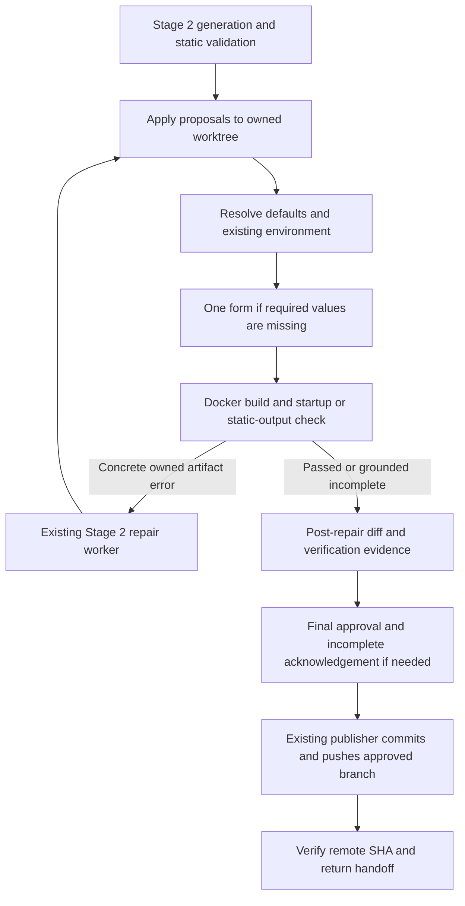

# Stage 3 execution architecture

Stage 3 checks the unpublished Stage 2 worktree before final artifact approval.
`ArtifactService` coordinates the existing components; `GitPublisher` remains the only publisher.

| Code | Responsibility |
| --- | --- |
| `artifacts/service.py` | Generation, execution, repair application, review, cancellation, and publication. |
| `execution/environment_analysis.py`, `environment.py` | Static discovery and volatile value handling. |
| `execution/planner.py`, `contexts.py` | Framework strategies and frozen eligible inputs. |
| `execution/runner.py`, `readiness.py` | Per-unit build, startup, HTTP, and static-output evidence. |
| `execution/docker_driver.py` | Bounded commands, resource ownership, and cleanup. |
| `execution/diagnostics.py`, `repair.py` | Failure classification and existing-task repair selection. |
| `execution/candidate.py`, `github/publisher.py` | Exact candidate identity and publication gate. |

`ExecutionRun` links plans, per-unit results, attempts, cleanup records, and an attestation.
Its states include `waiting_for_env`, `verifying`, `passed`, `verification_incomplete`, `failed`,
`blocked`, `cancelled`, and `interrupted`. Tasks follow build → startup → probe, or build → static
output. Independent units share the configured resource budget. Complete input digests determine reuse.

The existing project lock protects short state updates. An operation claim prevents competing
mutations while Docker runs outside the lock. Cancellation signals active work; recovery reconciles
recorded owned resources and interrupted attempts.

Final approval binds the post-repair diff and attestation. Before commit and push, the publisher
checks the actual reviewed tree and live configuration authority. Stage 5 receives the approved
branch, verified SHA, execution plan, and truthful status. No cloud deployment occurs here.
